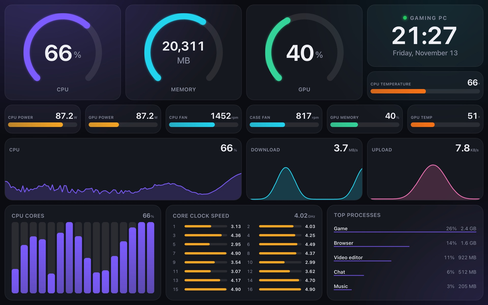
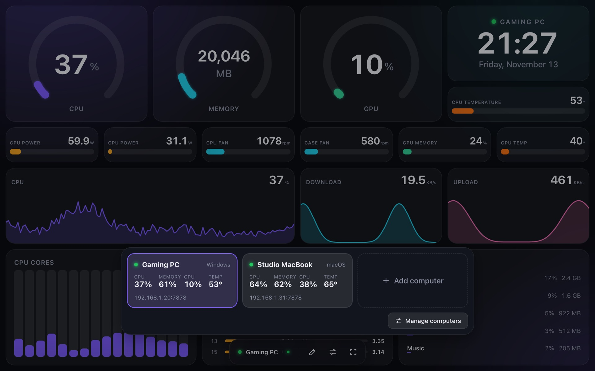
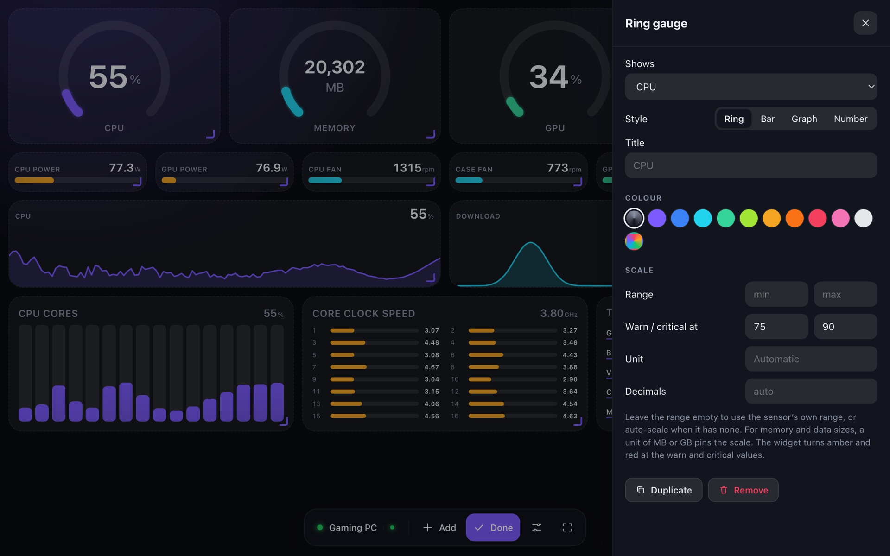
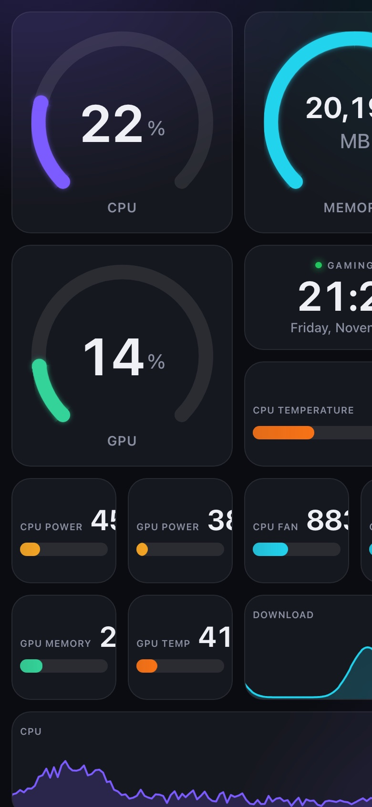
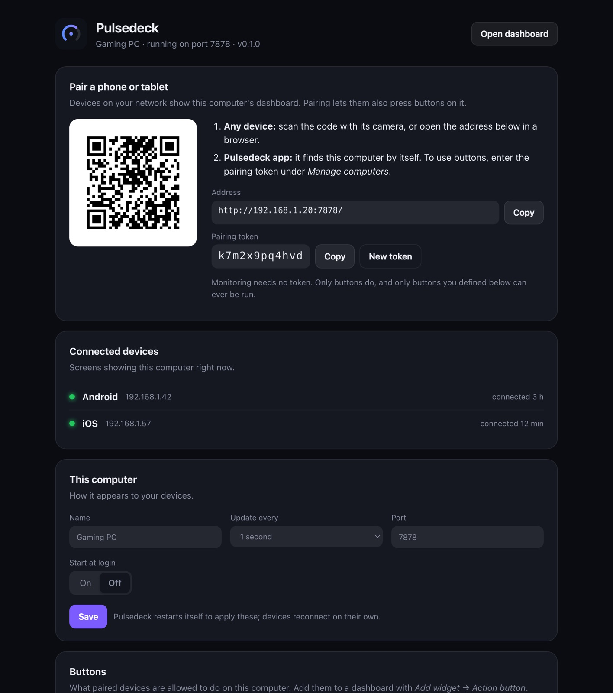

# Pulsedeck

Turn a spare phone or tablet into a live dashboard for your computer: CPU,
GPU, memory, temperatures, fans, power and network at a glance, plus buttons
for media keys, locking the screen and launching things.



A small **server** runs on the computer (macOS, Windows or Linux). Any
**device on the same network** shows the dashboard: the Android app, or simply
a browser on a phone, tablet or another computer. No account, no cloud.

| | |
| --- | --- |
|  |  |
| Several computers, one tap (or swipe) apart | Rearrange, resize and restyle everything |

## Install

Everything is on the [latest release](https://github.com/3ig/pulsedeck/releases/latest) page.
Pulsedeck is free and its builds are not signed with paid certificates, so
each system asks you to confirm once that you really want to run it. The steps
below include that.

### 1. The server, on the computer you want to monitor

**macOS** (11 or newer, Apple silicon and Intel)

1. Download [Pulsedeck-macos.dmg](https://github.com/3ig/pulsedeck/releases/latest/download/Pulsedeck-macos.dmg), open it and drag
   Pulsedeck to Applications.
2. Open it. macOS will say it cannot verify the developer: go to
   *System Settings → Privacy & Security*, scroll down and click **Open
   Anyway**. (Or run `xattr -dr com.apple.quarantine /Applications/Pulsedeck.app`
   once in Terminal.)
3. A gauge icon appears in the menu bar and the settings page opens.

**Windows** (10 or 11, 64-bit)

1. Download and run [Pulsedeck-windows-setup.exe](https://github.com/3ig/pulsedeck/releases/latest/download/Pulsedeck-windows-setup.exe).
   If SmartScreen appears, click **More info → Run anyway**. No administrator
   rights are needed.
2. Start Pulsedeck. If Windows Firewall asks, allow it on your network.
3. A gauge icon appears in the tray (it may be behind the **^** arrow).
4. For temperatures and fan speeds, run [HWiNFO](https://www.hwinfo.com/) with
   *Settings → General → Shared Memory Support* switched on. Everything else
   works without it.

**Linux** (x86-64 or ARM64)

Debian, Ubuntu and relatives:

```bash
sudo apt install ./pulsedeck-linux-amd64.deb
```

Fedora and relatives:

```bash
sudo dnf install ./pulsedeck-linux-amd64.rpm
```

Anything else: unpack `pulsedeck-linux-amd64.tar.gz` and run the `pulsedeck`
program inside. On a desktop it adds a tray icon; over SSH or on a machine
without a desktop it simply runs in the background.

On every system the tray / menu-bar icon offers **Pair a device…**, **Open
dashboard**, **Settings…**, **Start at login** and **Quit**.

### 2. The dashboard, on your phone or tablet

**Android:** download [Pulsedeck-android.apk](https://github.com/3ig/pulsedeck/releases/latest/download/Pulsedeck-android.apk) on the
device and open it (Android asks once to allow installing from your browser).
The app finds computers on your network by itself.

**Anything with a browser** (iPhone, iPad, another computer): open the address
shown on the server's settings page, or scan its QR code. On iOS, *Share → Add
to Home Screen* gives you a full-screen app.

### 3. Pair (only needed for buttons)

Monitoring works straight away. To let a device press buttons on the computer,
it needs the computer's pairing token: scanning the QR code includes it; in
the Android app, tap the computer's name in the dock, choose *Manage
computers* and enter it.

## Using the dashboard



* Tap anywhere to reveal the dock; it hides itself after a few seconds.
* **Edit** (pencil): drag widgets to move them, drag the corner to resize,
  tap a widget to configure it (sensor, style, colour, range, warn/critical
  thresholds). **Add** offers ring and bar gauges, graphs, numbers, per-core
  usage or clock speed, top processes, a clock, action buttons and text.
* **Several computers:** each computer has its own dashboards. The pill in the
  dock opens a switcher with a live card per computer; tap one to switch, or
  swipe sideways. A dual-boot PC keeps separate dashboards for each system.
* **Settings:** dark / light / auto theme, accent colour, card style, font,
  corner radius, spacing, background (including your own image), effects,
  fit-to-screen, several dashboards per computer, import / export.
* Want to look around first? Open any Pulsedeck server's address with `?demo`
  at the end for a dashboard of invented computers.

<br clear="right">

## The settings page



*Settings…* from the tray icon, or `http://localhost:7878/admin/`. It can only
be opened on the computer running Pulsedeck.

* **Pair a phone or tablet:** QR code, address and pairing token.
* **Connected devices:** which screens are showing this computer right now.
* **This computer:** name, update rate, port, start at login.
* **Buttons:** what paired devices may do here: media keys, open a link or
  app, run a command, lock the screen. Each has a Test button.
* **Plugins:** any command that prints a number becomes a sensor.

## What it reads

| | macOS (Apple silicon) | Linux | Windows |
| --- | --- | --- | --- |
| CPU usage, per-core usage | yes | yes | yes |
| Per-core clock speed | yes (IOReport) | yes (cpufreq) | yes (performance counters) |
| Memory in use, swap | yes (as Activity Monitor counts it) | yes | yes |
| Disk usage and I/O, network | yes | yes | yes |
| Temperatures | CPU, GPU, storage, battery (SMC) | CPU, NVMe, GPU and anything else in hwmon | via HWiNFO² |
| Fan speeds | yes (SMC) | hwmon tachometers; NVIDIA fan % | via HWiNFO²; NVIDIA fan % |
| CPU package power | yes (IOReport) | only if RAPL is readable¹ | yes (Energy Meter counters) |
| GPU usage, memory, power | yes (I/O Registry, IOReport) | NVIDIA (`nvidia-smi`), AMD (sysfs) | NVIDIA (`nvidia-smi`); others via performance counters |
| Everything else a monitoring tool knows | — | — | every HWiNFO reading² |

None of it needs root. `pulsedeck -sensors` prints every reading the machine
provides. All three columns have been verified on real hardware (Linux and
Windows on an AMD CPU with an NVIDIA GPU; the AMD/Intel GPU paths and Linux
motherboard fans are untested).

¹ Linux keeps the CPU energy counter root-only. To expose CPU power until the
next reboot: `sudo chmod a+r /sys/class/powercap/intel-rapl:0/energy_uj`.
Motherboard fans appear once the board's sensor driver is loaded (for example
`nct6775` or `it87`).

² Windows gives programs no temperatures or fan speeds without a kernel
driver. If [HWiNFO](https://www.hwinfo.com/) is running with *Shared Memory
Support* switched on (Settings → General), Pulsedeck publishes every reading
it shows, grouped as in HWiNFO, and uses its temperatures and fans for the
standard summary sensors. The free HWiNFO switches shared memory off again
after 12 hours.

## Wake with computer (Android)

*Computer name in the dock → Manage computers → Wake with computer.* With it
on, the tablet's screen turns on within a few seconds of a computer coming
online and goes off when none is connected.

* **Leave a computer out** with its *Wakes this screen* switch, for example a
  server or laptop that never sleeps; otherwise the screen stays on for as long
  as that one is reachable.
* **Turning the screen off:** by default the screen is released to the
  device's own timeout. Tablets set to stay awake while charging never reach
  it, so the panel offers *Allow* next to "Turn the screen off": Android then
  asks you to make Pulsedeck a device admin app, with the single ability to
  lock the screen.
* **Watching while asleep:** allow "Keep watching while asleep" too, or Android
  may cut the app off from the network after a while.

A small foreground service does the watching, so leave the tablet on its
charger. Turning the screen off by hand while a computer is running does not
wake it again.

## Security model

* The settings page answers only to a browser on the same computer (loopback
  address, loopback Host header, and a header cross-site pages cannot send).
* Reading stats needs no pairing, but the server refuses WebSocket connections
  from public web origins, so websites cannot read your machine through your
  browser.
* Anything that acts on the computer requires the pairing token.
* Clients can only trigger actions *by id*. What an action runs is defined in
  the config file on the computer and is never sent over the network.
* Traffic is unencrypted and meant for a trusted home/office network. Do not
  expose the port to the internet.

## Configuration file

Everything on the settings page is stored in one file, which you can also edit
by hand.

The config file is created on first run (its path is printed at startup; on
macOS `~/Library/Application Support/pulsedeck/config.json`).

```json
{
  "name": "studio-mac",
  "port": 7878,
  "interval_ms": 1000,
  "token": "…",
  "actions": [
    { "id": "playpause", "label": "Play / Pause", "icon": "play", "type": "media", "arg": "playpause" },
    { "id": "docs", "label": "Docs", "icon": "link", "type": "open", "arg": "https://go.dev/doc" },
    { "id": "backup", "label": "Backup", "icon": "terminal", "type": "command", "command": ["/usr/local/bin/backup.sh"] }
  ],
  "plugins": [
    { "id": "battery", "label": "Battery", "unit": "%", "min": 0, "max": 100, "interval_ms": 30000,
      "command": ["sh", "-c", "pmset -g batt | grep -o '[0-9]*%' | tr -d %"] }
  ]
}
```

* **Actions** — `media` (`playpause`, `next`, `prev`, `volup`, `voldown`,
  `mute`), `lock`, `open` (URL, file or app) and `command` (an argv to launch).
* **Plugins** — any command that prints a number (or short text). It shows up
  as the sensor `plugin.<id>` and can be bound to any widget.

On macOS the transport buttons control Spotify or Music (macOS has no public
API for the global media keys), and the first use asks for Automation
permission.

## Building from source

You need [Go](https://go.dev/dl/). The dashboard is plain HTML, CSS and
JavaScript with no build step; it is embedded in the server and packaged
as-is into the Android app.

```bash
make build
```

```bash
./dist/pulsedeck
```

| Command | Produces | Needs |
| --- | --- | --- |
| `make app` | macOS app and disk image | a Mac |
| `make dist` | Linux and Windows programs | Go only |
| `make installer` | Windows setup program | `makensis` |
| `make packages` | `.deb`, `.rpm`, `.tar.gz` | `nfpm` |
| `make apk` | Android app | JDK 17, Android SDK |

Pushing a tag such as `v1.2.3` makes GitHub build all of them and publish a
release ([release.yml](.github/workflows/release.yml)).

How the pieces fit:

```
            ┌────────────── computer ──────────────┐        ┌──── phone / tablet / browser ────┐
            │  pulsedeck (Go, one program)         │        │  client/  (HTML + CSS + JS)      │
 OS APIs ──▶│  sensors.go, hw_*.go   readings      │  ws    │  shown by                        │
 HWiNFO     │  main.go               hub, mDNS     │◀──────▶│   • any browser (served by the   │
 plugins    │  admin.go, tray.go     settings UI   │  JSON  │     server itself), or           │
            │  actions_*.go          buttons       │        │   • android/  thin native shell  │
            └──────────────────────────────────────┘        └──────────────────────────────────┘
```

The wire format is documented in [PROTOCOL.md](PROTOCOL.md), so other clients
and servers can be written against it.

## Status

Tested on macOS (Apple silicon), Windows 11 and Linux with an AMD CPU and
NVIDIA GPU, and on an Android tablet. Not yet covered: an iOS app (the browser
works), AMD and Intel GPUs on Windows, encrypted connections. Bug reports and
pull requests are welcome.

## Licence

[GPL-3.0](LICENSE). You may use, study, share and change Pulsedeck; versions
you distribute must stay under the same licence.
